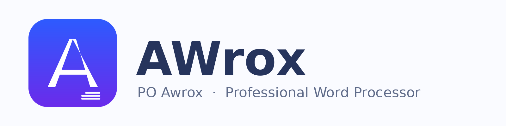

# AWrox — Releases

**AWrox** (full name **PO Awrox**) is a full-featured, professional **word processor** with a
Microsoft Word–style ribbon. English by default, switchable to 7 more languages from Settings.

This repository hosts **official builds and releases**. The source code lives in the
private repository `obsifox/awrox`.



## Download

Latest release: **https://github.com/obsifox/awrox-releases/releases/latest**

| Platform | File | Kind |
|----------|------|------|
| Windows 10/11 (64-bit) | `AWrox-Setup-<version>.exe` | Installer (NSIS) |
| Windows 10/11 (64-bit) | `AWrox-Portable-<version>.exe` | Portable, no install |
| Linux (64-bit) | `AWrox-<version>-x86_64.AppImage` | AppImage |
| Debian / Ubuntu | `awrox_<version>_amd64.deb` | deb package |
| Android 7+ | `AWrox-v<version>-android.apk` | APK |
| Web | served build | static HTML/JS |

Every release ships `SHA256SUMS-*.txt` checksum files and the app logo (`AWrox-Logo.png`,
`AWrox-Banner.png`).


## Feature highlights

- Professional ribbon: **File / Home / Insert / Layout / References / Review / View**
  plus contextual **Table** and **Header & Footer** tabs
- Real document engine (TipTap / ProseMirror)
- **Comments** with side panel, **Table of Contents** (live, click-to-jump), **Bookmarks**
- **Header & Footer** with page-number fields, **Watermark**, **Format Painter**
- **Right-click context menu** and **floating selection toolbar**
- Tables (resize, merge/split, header rows), resizable images, page breaks
- Page setup: A4/Letter/Legal, orientation, margins, page color, ruler, outline pane, zoom
- Find & Replace, styles gallery, RTL/LTR per paragraph, dark mode, focus mode, read aloud
- Native `.awrox.json` documents, export to DOC / HTML / TXT, print to PDF
- **English default UI** + فارسی، العربية، 中文， Español， Français، Deutsch، Русский

## Integrity

Verify downloads against the per-platform `SHA256SUMS-*.txt` files, e.g.:

```bash
sha256sum -c SHA256SUMS-linux.txt
```

## License

MIT © 2026 obsifox · PO Awrox
